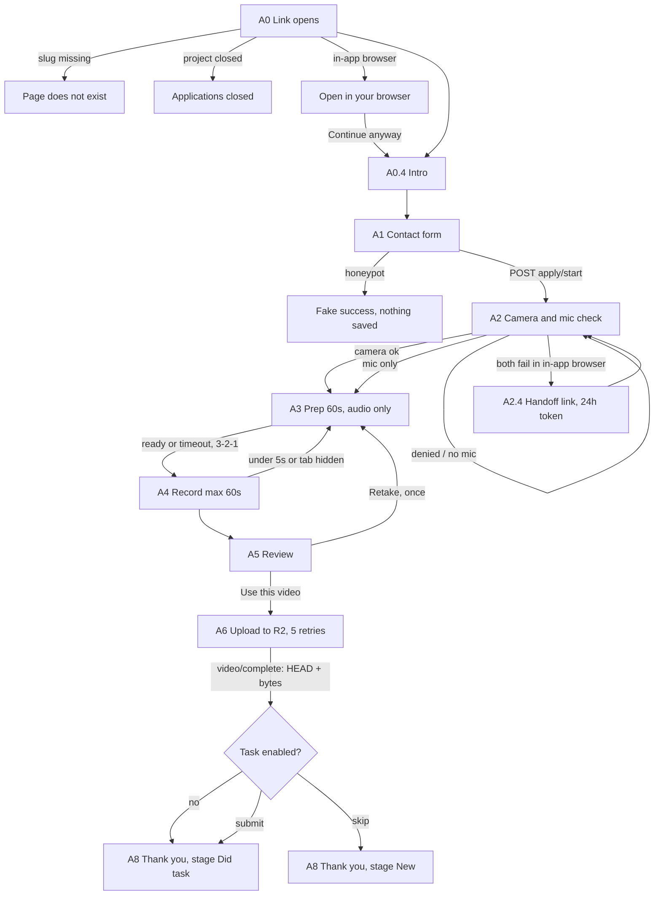
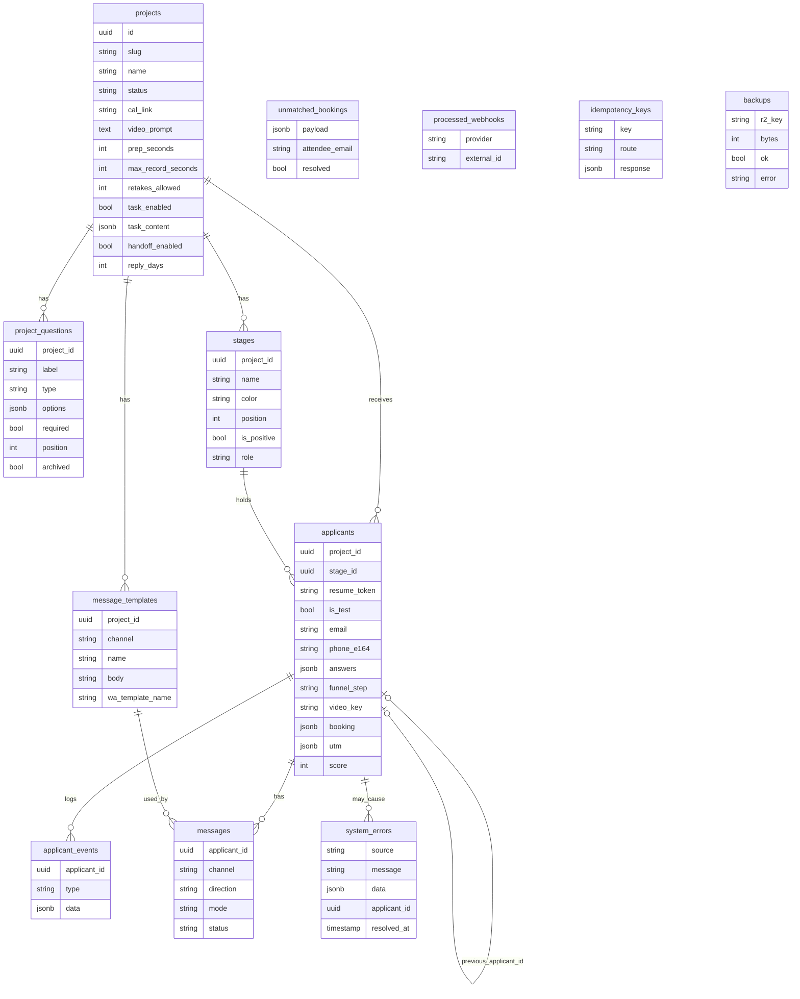

# PLAN: Forge Hire

Status (2026-10-21): foundation, funnel API, admin API, Cal.com webhook, cron/backup/restore and messaging provider code are built and tested (405 vitest tests, build clean, funnel Playwright 24/24 and dashboard Playwright 9/9 on real routes). Deployed to https://forge-hire.vercel.app. Open: production database split, live test console run, provider keys. See NEXT_STEPS.md.

## Progress

The actionable to-do lists (yours and mine) are in NEXT_STEPS.md.

| Phase | Scope | Status |
|---|---|---|
| 1 Foundation | Scaffold, brand tokens, Drizzle schema + first migration, R2 helper, admin key gate, seed, /api/health | Done 2026-10-21: Neon Development migrated and seeded, test branch, R2 bucket + CORS, 3 integration tests pass, /api/health ok. Production and Preview DBs: migrate and seed at deploy |
| 2 Applicant funnel | A01 to A16 UI, real camera/recorder/upload logic, mock API | Done and deployed to Vercel (https://forge-hire.vercel.app) |
| 3 Dashboard | Projects home, board + drag/drop, Did not finish, Table + CSV, drawer + video player, send modal, all 7 settings tabs | Done: admin API, DB-backed stores, Cal.com webhook, dashboard Playwright specs (9 green) |
| 4 Safety nets | Backups, integrity check, restore script, retention cron, banners | Done: cron routes, backup script + GitHub Action, restore proven, banners, real test console. Not run on Vercel/GitHub yet |
| 5 Messaging | Resend, WhatsApp Cloud API, GHL | Provider code and webhook built, mocked tests only. No live keys yet |

### Front-end verification (2026-10-21)
- `tsc --noEmit`, `pnpm lint`, `pnpm build`: clean.
- Vitest: 57 files, 241 tests passed, 3 skipped (the DB/R2 integration tests, which need keys).
- Playwright (run by the workers): funnel core 16/16 (8 specs at 390x844 and 1280x800), video flow 4 specs passed on Chrome fake media devices. Re-run: `pnpm exec playwright test` with a dev server (see CLAUDE.md).
- Dashboard interactions were clicked through in the browser by the lead and the workers. There are NO Playwright specs for the dashboard yet.
- Not verified: real iPhone Safari, real Android Chrome, Facebook and Instagram in-app browsers (see MANUAL_CHECKS.md).

### What is mock today (defaults; flip with the env switches in CLAUDE.md)
- The funnel talks to `FunnelApi` in `src/features/applicant-funnel/api/`. `mock-api.ts` is the default. `http-api.ts` already calls the spec routes and is selected with `NEXT_PUBLIC_FUNNEL_API=http`. The server routes do not exist yet.
- The dashboard stores (applicants, projects, settings) are in-memory with `localStorage` persistence. They are NOT synced with each other or with the funnel. Replace with API data in the backend phase.
- Test console runs a simulation behind `TestRunner`, `TestMessenger`, `TestDataStore` interfaces (`src/features/test-console/`).
- Send modal defaults to link mode (`NEXT_PUBLIC_SEND_MODE=api` switches the label only; no provider is wired).

### Known deviations from the spec and prototype
- Task body is stored as Tiptap HTML (`taskBody` string), not Tiptap JSON. The funnel renders it through a sanitizer (`applicant-funnel/lib/safe-html.ts`). The DB column `task_content` is jsonb and can hold either; decide when wiring the backend.
- Warm Ivory is `#FCFBF8` (from the prototype header). Red Deep `#B8302A` and Red Tint `#FCEFED` were added. The earlier guess `#E7E3DC` is now the border/line color.
- Next.js 16: `middleware` is renamed `proxy` (`src/proxy.ts`). `cacheComponents` and `partialPrefetching` from the scaffold are OFF (they conflict with `force-dynamic` on /api/health and nothing needs them).
- Funnel unknown slug returns HTTP 200 with "This page does not exist." (not 404). A closed project shows the closed screen after a short skeleton, unless the visitor has a saved session (spec G12).
- "Applicants this week" on Projects home counts everyone including Did not finish (25), prototype shows 18.
- Linking an unmatched booking to an applicant only updates the projects store. `ApplicantActions` has no `linkBooking`; add it with the backend.
- Time zone select is a custom searchable combobox. Phone country picker is a native select.
- Board card answer line wraps instead of truncating, so some cards are slightly taller than the prototype.
- Dev-only routes: `/dev/video-flow` (used by the video Playwright specs, returns 404 in production).
- A saved settings slug change moves its own localStorage key but is not propagated to the other stores.

## 1. Applicant journey



## 2. Data model



Full column lists follow the build prompt (uuid ids, created_at and updated_at in UTC on every table). `stages.role` is unique per project among non-null values. `processed_webhooks (provider, external_id)` and `idempotency_keys.key` are unique.

## 3. Pages and routes

Public pages: `/a/[slug]`
Admin pages (cookie gated, 404 otherwise): `/adminMatt/k/[key]`, `/adminMatt`, `/adminMatt/p/[slug]`, `/adminMatt/p/[slug]/settings`, `/adminMatt/test`
Public API: `POST /api/apply/start`, `/upload-url`, `/video/complete`, `/task`, `/handoff`, `/log`
Admin API: `/api/admin/*` (projects, stages, questions, applicants, move, notes, score, messages, templates, unmatched bookings, test console, delete test data)
Webhooks: `POST /api/webhooks/calcom`, `GET+POST /api/webhooks/whatsapp`
Health: `GET /api/health`
Cron (Vercel Cron to `/api/cron/*`, bearer `CRON_SECRET`): retention 03:00 UTC, integrity 05:00 UTC. Backup 04:00 UTC via GitHub Actions running `scripts/backup.ts` (pg_dump is not available in Vercel functions).

## 4. Phases

1. **Foundation**: scaffold (pnpm, strict TS, ESLint), Tailwind tokens, next/font, Drizzle schema + migration, R2 helper, admin key gate, seed Appointment Setter, /api/health. Tests: zod, phone, Cal link builder, template filler, DB + R2 integration, admin gate.
2. **Applicant funnel A0 to A8**: recorder (mp4/webm, 1.2 Mbps, 720p, thumbnail at 2s, fix-webm-duration), XHR upload with 5 retries, IndexedDB hold, idempotency, resume. Playwright at 390x844 and 1280x800 with fake media devices. MANUAL_CHECKS.md. **Deploy to Vercel, send funnel link.**
3. **Dashboard**: projects home, board (dnd), did-not-finish, table + CSV, drawer + player, settings tabs (Tiptap task editor), Cal link builder, Cal.com webhook.
4. **Safety nets**: nightly backup to R2 (30 days), integrity check, scripts/restore.ts with proven restore, retention, red banners, test console.
5. **Messaging**: Resend, WhatsApp Cloud API + webhook, GHL v2 (read current docs), link-mode fallback, "Send test to me".

## 5. Structure

```
src/
  app/         routes, layouts, middleware, thin API handlers
  features/    applicant-funnel, pipeline, applicant-review, bookings, messaging, retention, backups, test-console  (one index each)
  components/  ui, layout, forms, templates
  platform/    db, r2, email, whatsapp, ghl, logging
  shared/      zod primitives, phone and timezone utils
```

## 6. Decisions already made
Colors from the HTML (Signal Red #D93A31, Red Deep #B8302A, Red Tint #FCEFED, Deep Charcoal #0E1220, Warm Ivory #FCFBF8). Dashboard and funnel both match the HTML. Hosting moved from Railway to Vercel on 2026-10-21 (user decision). Postgres: Neon via Vercel Marketplace [assumption, any Postgres URL works]. Domain apply.forgeforward.io. Tests use a separate test DB and `test/` R2 prefix. Git identity for this repo: `vansteenbergenmatisse` / vansteenbergenmatisse@gmail.com. GitHub repo: https://github.com/vansteenbergenmatisse/forgeforward-hire-funnel-test. Brand logo is taken from the prototype and lives in `src/components/brand/logo.tsx`.

## 7. Open questions (default in brackets)
1. Ivory exact hex? RESOLVED: #FCFBF8 (prototype header comment).
2. Logo files in /public/brand/? RESOLVED for now: logo extracted from the prototype into a React component. Drop official files in /public/brand/ if they differ.
3. Test database URL (second Neon branch)? [I ask for TEST_DATABASE_URL in Phase 1]
4. Cal.com API header for signature? [check current Cal.com docs: `x-cal-signature-256`]
5. Rate limit storage without Redis? [Postgres table, no Redis]
6. pg_dump must match the server major version. [GitHub Actions job installs the matching postgresql-client]
7. Which R2 bucket name, and CORS limited to APP_URL and localhost:3000? [R2_BUCKET from you; I set CORS]
8. Is Meta WhatsApp template approved yet? [no; Phase 5 uses link mode until it is]
9. Admin key rotation or multiple admins? [single ADMIN_KEY, as spec]
10. Does "Interviewed" etc. stay global defaults on Duplicate? [yes, copied as is]

## 8. Env vars (.env.example)
APP_URL, CRON_SECRET, DATABASE_URL, TEST_DATABASE_URL, ADMIN_KEY, R2_ACCOUNT_ID, R2_ACCESS_KEY_ID, R2_SECRET_ACCESS_KEY, R2_BUCKET, CALCOM_WEBHOOK_SECRET, RESEND_API_KEY, EMAIL_FROM, EMAIL_REPLY_TO, WA_PHONE_NUMBER_ID, WA_ACCESS_TOKEN, WA_APP_SECRET, WA_VERIFY_TOKEN, GHL_PRIVATE_TOKEN, GHL_LOCATION_ID, TEST_EMAIL, TEST_PHONE

## 9. Backend notes (2026-10-21)
- Task body is stored as `{html}` in `task_content` (sanitized on write and read).
- Hired and Rejected terminal stages are matched by name (no role column).
- Task file name and size are not stored in their own columns; the drawer shows size 0. Optional schema change.
- Vercel: `DATABASE_URL` is one value for Development, Preview and Production and points at the Development Neon branch. Split before real applicants.
- The Postgres `pg_dump` for backups runs in GitHub Actions (postgresql-client 18, matches Neon). Locally: `brew install postgresql@18`.
- GHL v2 sends use header `Version: v3` (override `GHL_API_VERSION`).
- Rate limit store: Postgres by default, `FUNNEL_RATE_LIMIT_STORE=memory` for the in-memory one.
