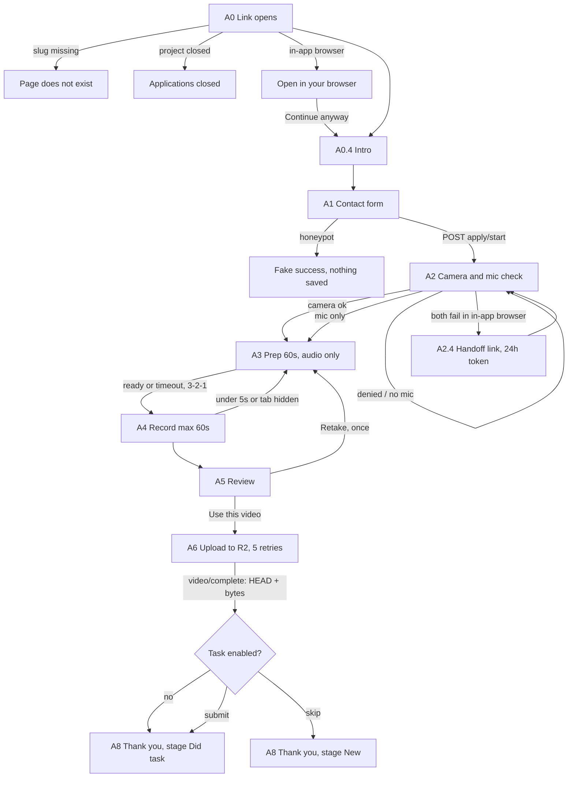
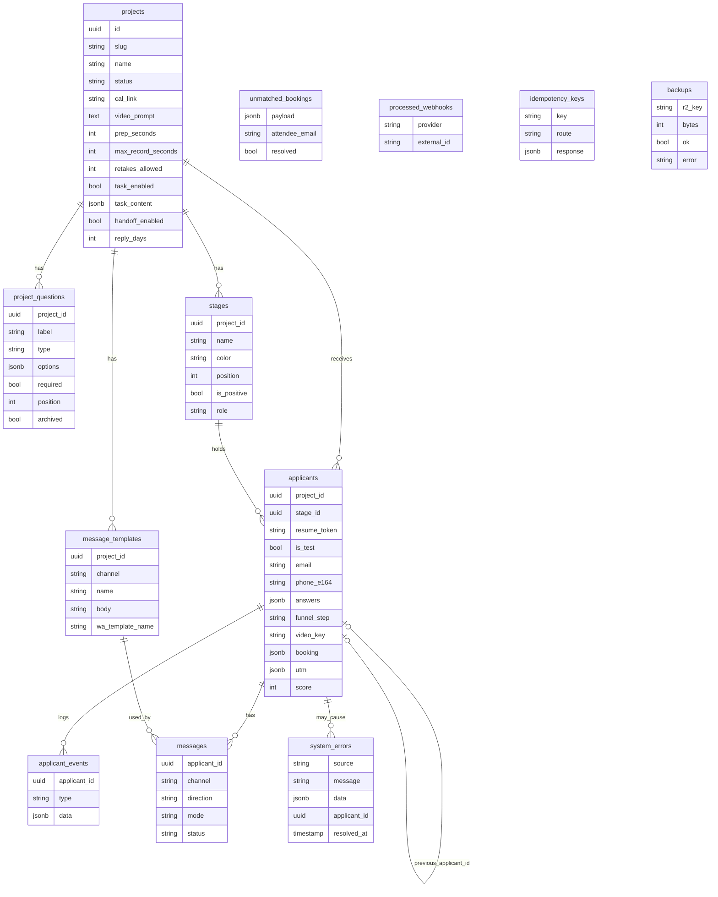

# PLAN: Forge Hire

Status: waiting for "go". No app code exists yet.

## 1. Applicant journey



## 2. Data model



Full column lists follow the build prompt (uuid ids, created_at and updated_at in UTC on every table). `stages.role` is unique per project among non-null values. `processed_webhooks (provider, external_id)` and `idempotency_keys.key` are unique.

## 3. Pages and routes

Public pages: `/a/[slug]`
Admin pages (cookie gated, 404 otherwise): `/admin/k/[key]`, `/admin`, `/admin/p/[slug]`, `/admin/p/[slug]/settings`, `/admin/test`
Public API: `POST /api/apply/start`, `/upload-url`, `/video/complete`, `/task`, `/handoff`, `/log`
Admin API: `/api/admin/*` (projects, stages, questions, applicants, move, notes, score, messages, templates, unmatched bookings, test console, delete test data)
Webhooks: `POST /api/webhooks/calcom`, `GET+POST /api/webhooks/whatsapp`
Health: `GET /api/health`
Cron (scripts/cron.ts on Railway): retention 03:00 UTC, backup 04:00 UTC, integrity 05:00 UTC

## 4. Phases

1. **Foundation**: scaffold (pnpm, strict TS, ESLint), Tailwind tokens, next/font, Drizzle schema + migration, R2 helper, admin key gate, seed Appointment Setter, /api/health. Tests: zod, phone, Cal link builder, template filler, DB + R2 integration, admin gate.
2. **Applicant funnel A0 to A8**: recorder (mp4/webm, 1.2 Mbps, 720p, thumbnail at 2s, fix-webm-duration), XHR upload with 5 retries, IndexedDB hold, idempotency, resume. Playwright at 390x844 and 1280x800 with fake media devices. MANUAL_CHECKS.md. **Deploy to Railway, send funnel link.**
3. **Dashboard**: projects home, board (dnd), did-not-finish, table + CSV, drawer + player, settings tabs (Tiptap task editor), Cal link builder, Cal.com webhook.
4. **Safety nets**: nightly backup to R2 (30 days), integrity check, scripts/restore.ts with proven restore, retention, red banners, test console.
5. **Messaging**: Resend, WhatsApp Cloud API + webhook, GHL v2 (read current docs), link-mode fallback, "Send test to me".

## 5. Structure

```
src/
  app/         routes, layouts, middleware, thin API handlers
  features/    applicant-funnel, pipeline, applicant-review, bookings, messaging, retention, backups, test-console  (one index each)
  components/  ui, layout, forms, templates
  platform/    db, r2, email, whatsapp, ghl, logging
  shared/      zod primitives, phone and timezone utils
```

## 6. Decisions already made
Colors from the HTML (Red #D93A31, Charcoal #0E1220, Ivory #E7E3DC). Dashboard and funnel both match the HTML. Railway project and Postgres exist. Domain apply.forgeforward.io. Tests use a separate test DB and `test/` R2 prefix. Phases run without pauses.

## 7. Open questions (default in brackets)
1. Ivory exact hex? [#E7E3DC from the HTML; confirm]
2. Logo files in /public/brand/? [placeholder wordmark in Barlow Condensed until provided]
3. Test database URL (second Railway DB)? [I ask for TEST_DATABASE_URL in Phase 1]
4. Cal.com API header for signature? [check current Cal.com docs: `x-cal-signature-256`]
5. Rate limit storage without Redis? [Postgres table, no Redis]
6. Cron service on Railway needs pg_dump matching server major version? [install matching postgresql-client in the cron Docker image]
7. Which R2 bucket name, and CORS limited to APP_URL and localhost:3000? [R2_BUCKET from you; I set CORS]
8. Is Meta WhatsApp template approved yet? [no; Phase 5 uses link mode until it is]
9. Admin key rotation or multiple admins? [single ADMIN_KEY, as spec]
10. Does "Interviewed" etc. stay global defaults on Duplicate? [yes, copied as is]

## 8. Env vars (.env.example)
APP_URL, DATABASE_URL, TEST_DATABASE_URL, ADMIN_KEY, R2_ACCOUNT_ID, R2_ACCESS_KEY_ID, R2_SECRET_ACCESS_KEY, R2_BUCKET, CALCOM_WEBHOOK_SECRET, RESEND_API_KEY, EMAIL_FROM, EMAIL_REPLY_TO, WA_PHONE_NUMBER_ID, WA_ACCESS_TOKEN, WA_APP_SECRET, WA_VERIFY_TOKEN, GHL_PRIVATE_TOKEN, GHL_LOCATION_ID, TEST_EMAIL, TEST_PHONE
